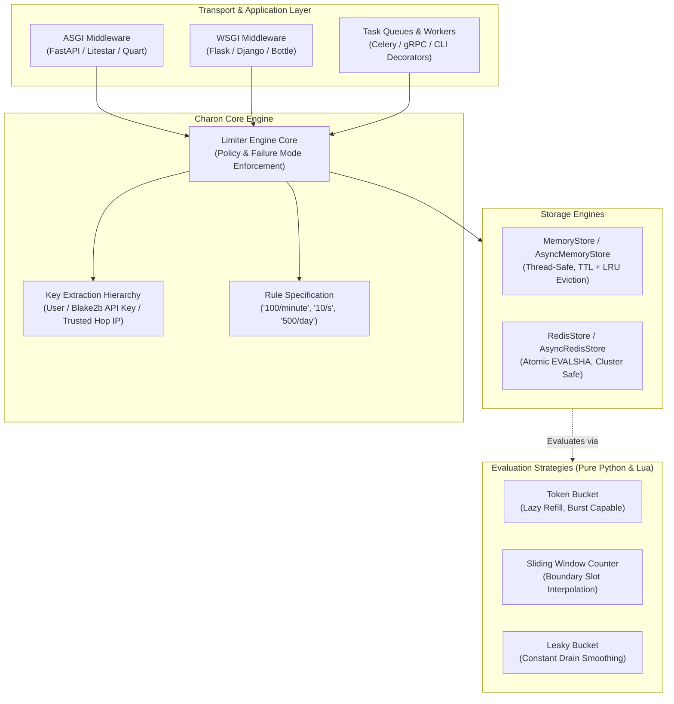

<div align="center">

# Charon

**High-performance, framework-agnostic distributed rate limiter SDK for Python**

[](https://www.python.org/downloads/)
[](https://opensource.org/licenses/MIT)
[](https://mypy.readthedocs.io/)
[](https://github.com/astral-sh/ruff)
[](#features)
[](https://datatracker.ietf.org/doc/draft-ietf-httpapi-ratelimit-headers/)

</div>

---

Charon is a lightweight, framework-agnostic rate limiting and traffic-shaping SDK designed to protect Python web services, background task workers, and APIs from traffic spikes and abuse.

Unlike framework-specific rate limiters (e.g. `slowapi` or `django-ratelimit`), Charon decouples rate-limiting semantics from transport protocols. The exact same rate rules, atomic state transitions, and quota tracking apply identically across **FastAPI**, **Flask**, **Django**, **Litestar**, **Celery**, and **gRPC** handlers.

---

## Architecture & System Topology



---

## Features

* **Zero Core Dependencies**: The core SDK has zero third-party dependencies and runs purely on Python standard library primitives.
* **Dual-Target Strategy Pattern**: Every algorithm is implemented in pure Python (for process-local in-memory storage) and in atomic Redis Lua scripts (for distributed coordination across Gunicorn/Uvicorn workers).
* **Eliminates Race Conditions**: Distributed state evaluations execute inside a single atomic Redis `EVALSHA` transaction, eliminating check-then-set race conditions without distributed locks.
* **RFC/IETF Aligned**: Produces standards-compliant HTTP response headers based on [draft-ietf-httpapi-ratelimit-headers](https://datatracker.ietf.org/doc/draft-ietf-httpapi-ratelimit-headers/) (`RateLimit-Limit`, `RateLimit-Remaining`, `RateLimit-Reset`, `Retry-After`).
* **Security-First Key Extraction**:
  * **No Unverified Token Parsing**: Never decodes unverified JWT tokens (which attackers can forge to bypass limits); consumes authenticated principal state provided by your auth middleware.
  * **Hashed API Secrets**: API keys are hashed via `blake2b` prior to storage, ensuring plaintext credentials never appear in Redis or logs.
  * **Proxy Hop Spoofing Protection**: `X-Forwarded-For` is parsed against a configurable `trusted_hops` chain, stripping client-forged prefix headers and collapsing IPv4-mapped IPv6 addresses.
* **Configurable Failure Modes**: Choose `FAIL_OPEN` (allow traffic if Redis drops to protect uptime) or `FAIL_CLOSED` (strictly reject traffic on storage error).
* **Transport Agnostic**: Native pure-protocol ASGI and WSGI middleware with zero framework imports.

---

## Algorithm Comparison

| Algorithm | State Model | Burst Capable | Smooth Rate | Best For |
| :--- | :--- | :---: | :---: | :--- |
| **Token Bucket** | `(tokens, last_refill_ms)` | **Yes** | No | General API throttling, burst-friendly client workflows. Lazy refill eliminates background timer threads. |
| **Sliding Window** | `(slot_ms, current, previous)` | No | **Yes** | Eliminates double-burst exploits at window edges with minimal memory footprint (two counters). |
| **Leaky Bucket** | `(level, last_leak_ms)` | No | **Yes** | Traffic shaping, downstream queue protection, and strict rate smoothing. |

---

## Installation

```bash
# Core package (zero dependencies, in-memory store)
pip install charon-ratelimit

# With distributed Redis support
pip install "charon-ratelimit[redis]"
```

---

## Quickstart

### 1. Direct Engine Usage (Sync or Async)

```python
from charon import Limiter, MemoryStore, Rule

# In-memory limiter with token bucket algorithm
store = MemoryStore()
rule = Rule.parse("10/minute")
limiter = Limiter(storage=store, rule=rule)

# Evaluate a key
result = limiter.check("user:12345")

if result.is_allowed:
    print(f"Request allowed! Remaining: {result.remaining}")
else:
    print(f"Throttled! Retry in {result.retry_after_seconds}s")
```

### 2. FastAPI / ASGI Integration

```python
from fastapi import FastAPI
from charon import Limiter, Rule
from charon.adapters.asgi import RateLimitMiddleware
from charon.storage.redis import AsyncRedisStore

app = FastAPI()

# Distributed rate limiter using Async Redis
store = AsyncRedisStore(url="redis://localhost:6379/0")
limiter = Limiter(
    storage=store,
    rule=Rule.parse("100/minute"),
)

# Protect all routes; automatically sets RateLimit-* headers
app.add_middleware(
    RateLimitMiddleware,
    limiter=limiter,
    exempt=lambda req: req.path == "/healthz",
)

@app.get("/api/data")
async def get_data():
    return {"status": "ok"}
```

Outgoing HTTP response headers:
```http
HTTP/1.1 200 OK
Content-Type: application/json
RateLimit-Limit: 100
RateLimit-Remaining: 99
RateLimit-Reset: 14
```

When throttled:
```http
HTTP/1.1 429 Too Many Requests
Content-Type: application/json
RateLimit-Limit: 100
RateLimit-Remaining: 0
RateLimit-Reset: 14
Retry-After: 14

{"error": "rate_limit_exceeded", "limit": 100, "retry_after": 14}
```

### 3. Flask / WSGI Integration

```python
from flask import Flask
from charon import Limiter, Rule
from charon.adapters.wsgi import RateLimitMiddleware
from charon.storage.redis import RedisStore

flask_app = Flask(__name__)

store = RedisStore(url="redis://localhost:6379/0")
limiter = Limiter(storage=store, rule=Rule.parse("50/minute"))

# Wrap the WSGI application
flask_app.wsgi_app = RateLimitMiddleware(
    flask_app.wsgi_app,
    limiter=limiter,
)
```

### 4. Background Workers & Function Decorators (Celery / CLI)

```python
from charon import Limiter, RedisStore, Rule

store = RedisStore(url="redis://localhost:6379/0")
limiter = Limiter(storage=store)

# Rate limit background tasks by account ID
@limiter.limit(Rule.parse("10/second"), key=lambda account_id, *args: f"account:{account_id}")
def sync_third_party_api(account_id: str):
    # Will raise RateLimitExceeded if called faster than 10 req/s for that account
    ...
```

---

## Key Extraction Hierarchy

When wrapping HTTP requests, Charon extracts identities via a deterministic three-tier hierarchy:

1. **Validated Auth Context**: Inspects application session state (`scope["state"]["user"]`, `scope["user"]`, `REMOTE_USER`). No tokens are decoded in Charon.
2. **Hashed API Key**: Extracts `X-API-Key` or `Authorization: Bearer <key>`, then passes it through `hashlib.blake2b` to generate a collision-resistant pseudonymous bucket key.
3. **Network Identity**: Obtains peer IP. If behind reverse proxies, configure `ClientIP(trusted_hops=1)` to inspect `X-Forwarded-For` safely without opening spoofing vulnerabilities.
4. **Anonymous Fallback**: Defaults to `"anonymous"` if no identity attributes match.

```python
from charon.keys import ApiKey, AuthenticatedUser, ClientIP, FirstOf

custom_extractor = FirstOf(
    AuthenticatedUser(state_keys=("user", "auth"), attributes=("sub", "id")),
    ApiKey(header_name="x-api-key"),
    ClientIP(trusted_hops=1),
    fallback="guest",
)

limiter = Limiter(storage=store, key_extractor=custom_extractor)
```

---

## Fault Tolerance & Failure Modes

When your storage layer (e.g. Redis) encounters a network partition, timeout, or outage, Charon applies an explicit failure mode policy:

* **`FailureMode.FAIL_OPEN` (Default)**: Logs the failure warning and grants requests full headroom quota. Ensures business continuity during telemetry/cache outages.
* **`FailureMode.FAIL_CLOSED`**: Rejects inbound traffic with HTTP 429 when storage is unreachable. Crucial for billing-critical or DDoS-sensitive endpoints.

```python
from charon import FailureMode, Limiter

limiter = Limiter(
    storage=store,
    rule=Rule.parse("100/minute"),
    failure_mode=FailureMode.FAIL_CLOSED,
)
```

---

## Testing & Verification

Charon includes a deterministic test suite utilizing manual wall-clock virtualization (`ManualClock`), ensuring zero flaky timing tests:

```bash
# Run test suite
pytest -v

# Run linter
ruff check .

# Run static type checker in strict mode
mypy
```

---

## License

MIT License. See [LICENSE](LICENSE) for details.
